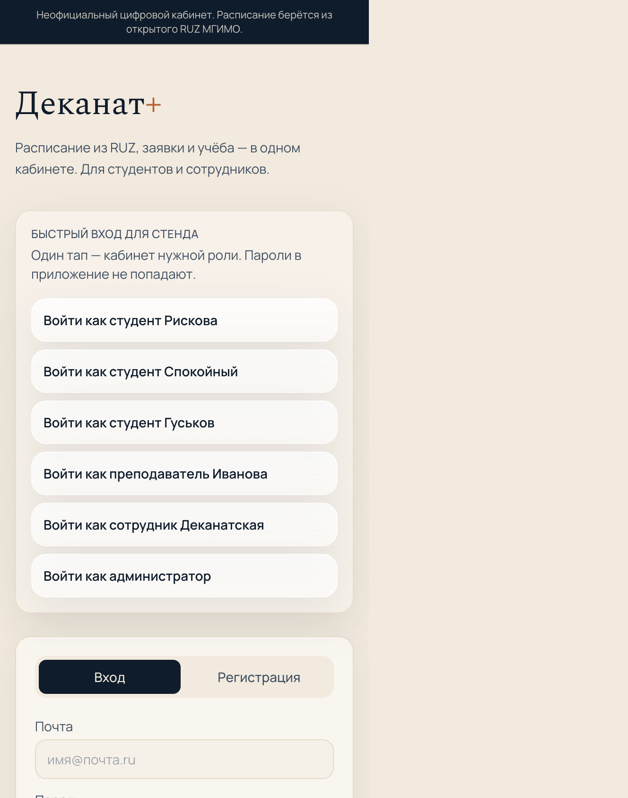
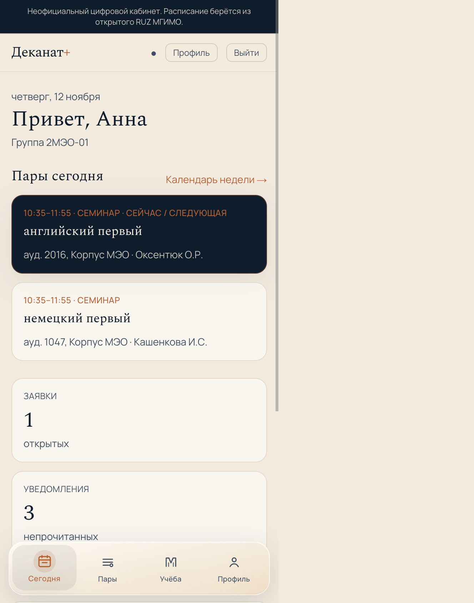
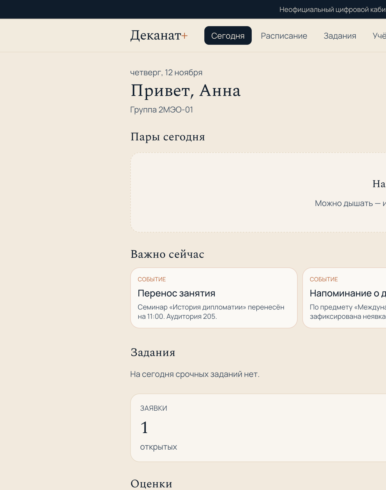
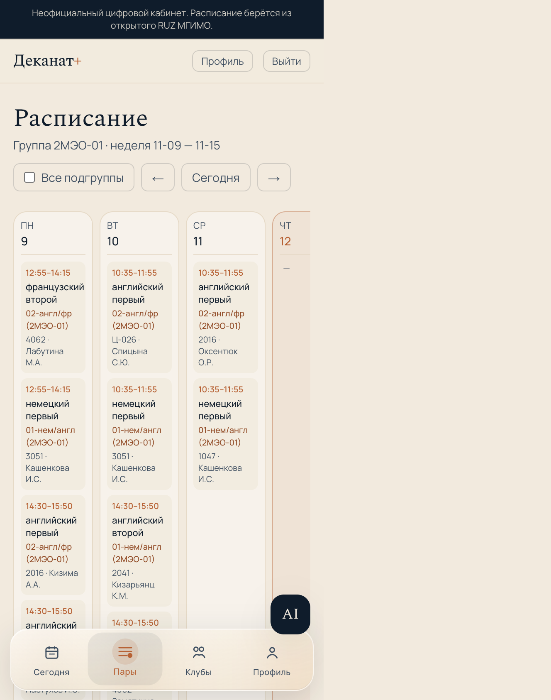
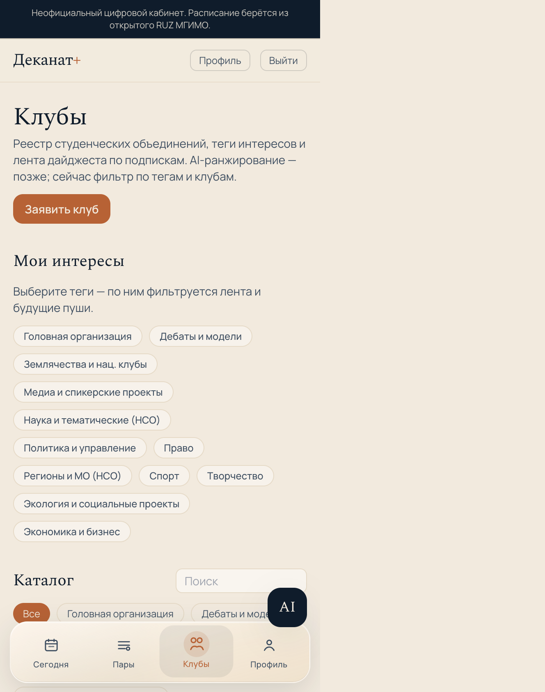
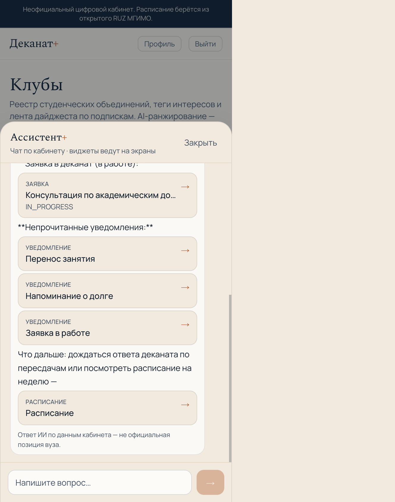
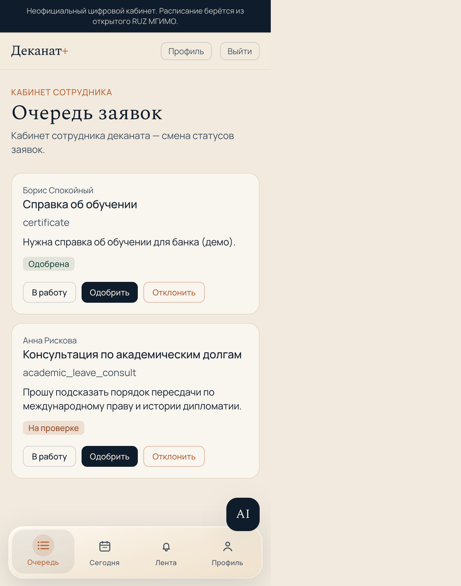

# Деканат+ — процесс сборки с ИИ (черновик PDF для жюри)

**Статус:** DRAFT · 2026-11-12 · без выдуманных результатов опроса/ФГ  
**Продукт:** неофициальный цифровой кабинет (MGIMO×AI Challenge, номинация «Вайб-кодинг»)  
**Live:** https://dekanat.177.177.212.34.sslip.io · API https://api.dekanat.177.177.212.34.sslip.io  
**Связь с критериями:** 1 проработанность · 2 нейротехнологии · 3 имплементация · 4 качество

---

## 1. Проблема студентов и выбор разделов

### Проблема своими словами

Учёба студента размазана по разным каналам: расписание (RUZ / чужие боты), заявки и справки «в тишине», оценки и долги без понятного «что делать дальше», объявления и переносы тонут в чатах. С телефона особенно больно: много тапов, разные приложения, нет одного «сегодня».

Источник болей: `docs/PAINS.md` (бриф + гипотезы). Полевое подтверждение (R-SURVEY / R-FG) **ещё не закрыто** — см. `docs/questions.md` Q1/Q1b. В этом черновике **нет** выдуманных цифр опроса.

### Почему эти разделы кабинета

| Экран | Какую боль закрывает |
|-------|----------------------|
| Сегодня | Одна точка входа в день (S1, S2, S5, S8) |
| Расписание | Переносы и подгруппы из открытого RUZ (S5) |
| Учёба / задания | «Как у меня дела» и next actions (S6) |
| Заявки | Статус вместо «подал и тишина» (S4, D1–D3) |
| Уведомления | Переносы и дедлайны в одной ленте (S5, S8) |
| Клубы | Живой реестр (~97 на live), подписки по интересам |
| Профиль / роли | Студент vs сотрудник; выбор группы/подгруппы |
| In-app ИИ | Черновик заявки, next actions, разбор уведомления, чат по состоянию кабинета |

### Что узнали у однокурсников

- Черновик опроса: `docs/research/survey-draft.md`
- Статус: **Q1 / Q1b open** — опрос в группу и фокус-группа ещё не проведены / не запротоколированы.
- Честно для жюри: кабинет собран на болях брифа + desk research; усиление критерия 1 полевыми данными — следующий шаг команды.

---

## 2. Перечень ИИ-инструментов / IDE / сервисов

| Инструмент / сервис | Зачем |
|---------------------|--------|
| Cursor (агенты / Composer) | Основная среда вайб-сборки кода и документов |
| Скилл `/idea` | Стратегия до кода (P0–P4), kill-first, Monte Carlo failure modes |
| Iron Ring / git worktrees | Изоляция фич, параллельные ветки, merge на `main` |
| Z Code (`api.z.ai`, OpenAI-compatible) | In-product AI1–AI4; ключ только в env |
| Docker / Compose / GHCR / VPS | Сборка образов, деплой, HTTPS |
| Caddy + sslip.io | Публичный HTTPS из РФ без VPN (web + api) |
| Postgres + Redis + worker | SoT кабинета; RUZ sync по cron |
| RUZ `ruz.mgimo.ru` | Живое открытое расписание (не ИИ) |
| OR-Tools CP-SAT | Только research-постановка авторасписания, **без солвера в MVP** |
| gstack / browse / Playwright (по факту) | QA и dogfood |
| Next.js PWA + Expo mobile | Поверхности web/mobile |
| Pandoc | Этот черновик PDF |

**Отменено owner 2026-11-12:** Telegram-бот как поверхность сдачи (без bot-контейнера / TELEGRAM_PROXY / gost egress на VPS). Исторический след в process-log остаётся, в демо жюри — web/PWA (+ mobile по готовности).

---

## 3. Ключевые этапы, промпты и фейлы

### Этап 0 — стратегия (`/idea`, 2026-11-04)

- Owner: бриф «цифровой деканат» + «как выиграть хакатон?»
- Пайплайн P0→P4: situation → options A–D → выбор **C** (Process Theatre + RUZ) → MC N=8 → strategy.
- Удачный якорь: criteria-first + in-product AI как имба, не FAQ-чат.
- Фейл: параллельные MC-writers перетёрли trials → reconcile aggregate.

След: `docs/process-log/2026-11-04-strategy-idea-skill.md`

### Scaffold / build start (2026-11-08)

Monorepo api/web/mobile/worker, JWT, seed demo, Docker Compose, первые ADR.  
След: `2026-11-08-build-start.md`, CHANGELOG `0.1.0`.

### Competitive research

Desk research ЛК вузов РФ; не dual СамГТУ; не «офиц. сервис МГИМО».  
След: `2026-11-08-competitive-research.md`, `docs/research/*`.

### Ironring batch 10–11 ноября

Слиты фичи: RUZ subgroup/SoT, clubs, teacher cabinet, demo quick-login, in-app AI, Caddy HTTPS, PWA push, profile role/group picker.  
Фейлы: VPS OOM / multi-agent image race; tip-cut паузы; SSH timeout; конфликтные данные РУЗ (~80 пересечений/нед); Wish нет в API.  
След: `ironring-batch-2026-11-10-11.md`.

### RUZ-домен + матмодель (2026-11-11)

Постановка авторасписания v1 фактами RUZ **без** кода солвера; каркас PDF жюри.  
След: `2026-11-11-ruz-domain-and-jury-process.md`, `docs/research/timetable-optimization-model.md`.

### 2026-11-12 (этот срез)

- Owner: Telegram-поверхность сдачи отменена.
- Live health: web/api 200; clubs ≈97; api/web `ebc7780`; tip `5fadc9d` docs-heavy — tip-cut **не** делали.
- Поднят только RUZ worker (`restart: unless-stopped`); bot не стартуем.
- Smoke in-product `/ai/chat` → `source: zcode`.
- Пакет скринов live + черновик owner sign-off кр.3 + mobile→live dogfood notes (без выдуманных опросов).

---

## 4. Путь идея → кабинет (скриншоты live 2026-11-12)

Каталог: [`screenshots/2026-11-12/`](./screenshots/2026-11-12/) (viewport ~390×844 + один desktop 1440×900).

### Login / demo quick-login

### Студент — Сегодня (mobile)

### Студент — Сегодня (desktop)

### Расписание (подгруппы RUZ)

### Клубы (реестр ~97)

### In-app ИИ (Ассистент+ + дисклеймер)

### Сотрудник — очередь заявок

Ещё желательно в финале (не блокирует этот черновик): кадр стратегии/vault; ранний wire; empty/error; преподаватель; Expo на устройстве.

---

## 5. Вход, данные, защита (простыми словами)

- Регистрация/login → JWT; demo quick-login по personaId **без** паролей в JS-бандле (`docs/DEMO.md`).
- Только вымышленные ПДн; demo-аккаунты (Рискова, Спокойный, Иванова, Деканатская…).
- IDOR (smoke 2026-11-12): Борис `GET /requests/{id Анны}` → **404**; в списке только свои заявки. Юнит/интеграционные тесты изоляции в api — рядом в репо.
- Пароли bcrypt/argon2; секреты в `.env` на VPS, не в git.
- LLM-ключ (`ZCODE_API_KEY`) только сервер; в ответе ИИ — дисклеймер «не офиц. позиция вуза» (см. скрин AI).
- Дисклеймер в UI: неофициальный кабинет; расписание из открытого RUZ.

Owner sign-off критерия 3: черновик чеклиста [`owner-signoff-criterion3-checklist.md`](./owner-signoff-criterion3-checklist.md) — **подписи Романа ещё нет**.

---

## 6. Что делал человек (owner), а не только агент

- Доступ к VPS, DNS/sslip, HTTPS через Caddy.
- Demo accounts / seed и проверка сценариев.
- Решение по LLM (Z Code) и по отмене Telegram-поверхности (2026-11-12).
- Sign-off кр.3 и полевые R-SURVEY/R-FG — в очереди.
- Expo dogfood на живом API — команды для owner в `2026-11-12-mobile-expo-live-dogfood.md`.

---

## Definition of done (статус черновика)

| Пункт | Статус |
|-------|--------|
| 6 разделов брифа заполнены текстом | да (полевые цифры — placeholder) |
| Скриншоты live | да (пакет 2026-11-12) |
| Удачи и фейлы | да |
| Нет секретов / боевых ПДн / лого вуза | да |
| Связь с критериями 1–4 | да |
| Экспорт PDF | этот файл → `jury-process-draft-2026-11-12.pdf` |
| Результаты опроса / ФГ | **placeholder** — не выдуманы |
| Owner sign-off кр.3 | черновик есть, подпись нет |

**Не выдумывать:** результаты опроса, протокол ФГ, «официальность» вуза, готовность mobile store.
